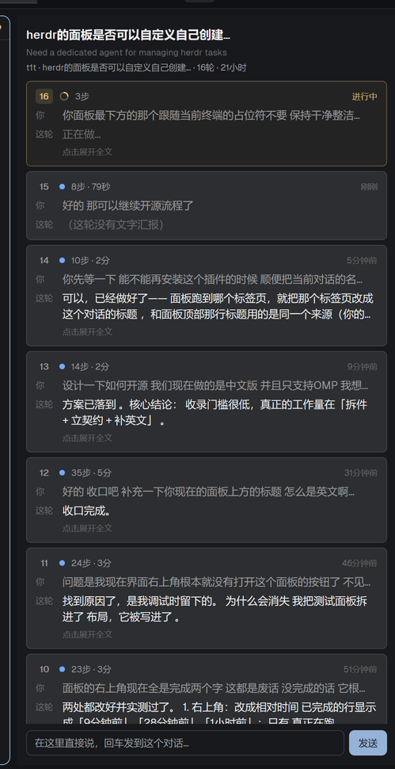

# rounds — a progress panel for Herdr

One row per instruction, for the conversation you are looking at: what you asked, what that turn got
done, how long it took. The newest round is live; finished rounds say "9m ago".



Built for people who run several agents at once and lose track of which tab is doing what.

## Install

A mod is a folder. Ask your agent to do it, or:

```sh
git clone https://github.com/<you>/herdr-rounds
cp -r herdr-rounds/mods/rounds ~/.config/herdr-app/mods/rounds
```

Herdr docks it on the right the first time it sees the folder (`mod.json`: `"place":"right"`), so it also
shows up in layouts you make later. To rename or move it, edit your layout; nothing else is required.

**The panel needs a data source.** It reads `~/.herdr-rounds/rounds/<terminal>.jsonl` — see
[CONTRACT.md](CONTRACT.md). Ships with an adapter for [omp](https://omp.dev):

```sh
cp adapters/omp/rounds-omp.ts ~/.omp/agent/extensions/rounds-omp.ts
```

Any other agent works too: call `bin/rounds-write.mjs` from a hook (`start` / `step` / `end`), or write
the two fields yourself. The panel is a reader — it never talks to your model.

## What it does

- **Follows the visible tab.** Switching tabs switches conversations; the panel never mixes two.
- **Live while it runs.** The running round appears the moment you send, and its step count grows.
- **Three lines, then click.** Cards stay compact; a click expands both halves.
- **Send from the panel.** Type at the bottom, press Enter or the Send button — it types into that
  conversation for you.
- **Names the tab.** An unnamed tab is renamed after its conversation; a name you typed is never touched.
- **English and Chinese**, picked from the system locale; click the `EN`/`ZH` chip to switch.

## Privacy

Reads only `~/.herdr-rounds` and, in the omp adapter, the session transcript it is recording. No network,
no telemetry, nothing leaves the machine. The panel shows a shortened form of what you typed — keep that
in mind when sharing your screen.

## Layout

```
mods/rounds/       the panel (herdr mod)
adapters/omp/      one writer: an omp extension
bin/rounds-write.mjs   a writer any agent's hook can call
test/              node --test, no herdr needed
CONTRACT.md        the file format
RECIPE.md          a brief to rebuild this from an empty folder
```

## Contributing

Issues and PRs welcome. `node --test test/` must stay green, and a mod change must pass
`herdr-app check mods/rounds` before you open the PR. Keep the data format backwards compatible;
breaking changes go in a major version.

## License

MIT.
