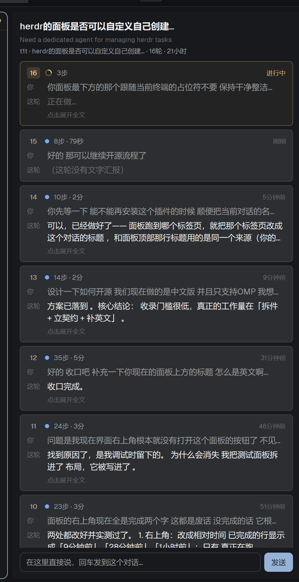

# rounds — Herdr 的进度面板

一条指令一行，只看你当前正在看的那个对话：你说了什么、这轮做成了什么、花了多久。最新那轮实时显示，
做完的显示「9 分钟前」。



给同时开好几个 agent、已经记不清哪个标签在干什么的人用。

## 安装

mod 就是一个文件夹。让 agent 来做，或者：

```sh
git clone https://github.com/<you>/herdr-rounds
cp -r herdr-rounds/mods/rounds ~/.config/herdr-app/mods/rounds
```

Herdr 第一次看到这个文件夹就把它停靠在右侧（`mod.json`：`"place":"right"`），以后新建的布局也带它。

**面板需要数据源**：它读 `~/.herdr-rounds/rounds/<终端>.jsonl`（格式见 [CONTRACT.md](CONTRACT.md)）。
自带 omp 适配器：

```sh
cp adapters/omp/rounds-omp.ts ~/.omp/agent/extensions/rounds-omp.ts
```

别的 agent 也行：在 hook 里调 `bin/rounds-write.mjs`（`start` / `step` / `end`），或自己写那两行 JSON。
面板只是读者，不会和你的模型通信。

## 特性

- **跟随可见标签页**：切标签就切对话，绝不串台
- **运行中实时**：发出即刻出现，步数边跑边涨
- **三行封顶**：点卡片展开全文
- **面板里直接发**：输入框 + 发送按钮（回车同效）
- **自动命名标签**：没起过名的标签按对话命名；你手动起过的名字不碰
- **中英双语**：跟随系统语言，点右上角 `EN/ZH` 切换

## 隐私

只读 `~/.herdr-rounds`；omp 适配器另读它正在记录的会话文件。不联网、无遥测。面板显示的是你输入的
摘要，投屏时注意。

## 许可

MIT。
